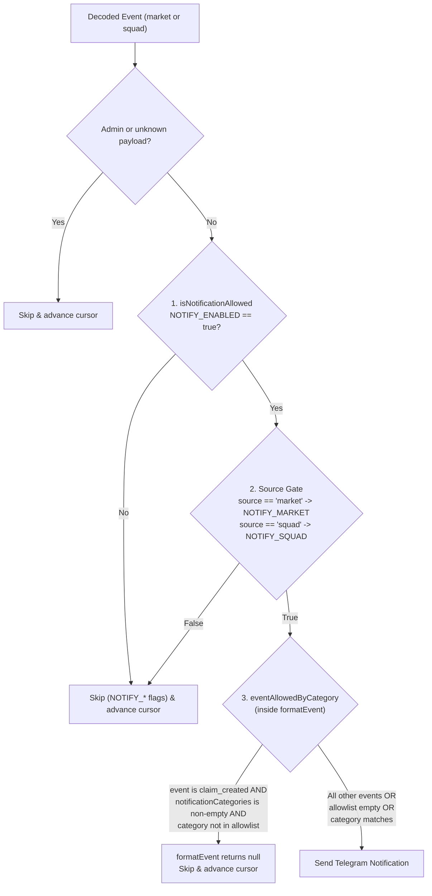

# Notification Filters

The Mimir Telegram bot reads eight environment variables that gate or filter outbound Telegram notifications. Because several of their names look similar, this document specifies what each variable filters, its default value, how multiple variables interact, and how to configure common scenarios.

---

## 1. Filter Groups & Summary Table

The eight variables fall into two distinct functional layers:

1. **Coarse Boolean Feature Flags** ([`src/notifications/featureFlags.ts`](../src/notifications/featureFlags.ts)): Global and per-contract kill switches (`NOTIFY_ENABLED`, `NOTIFY_MARKET`, `NOTIFY_SQUAD`) evaluated in the poller via [`isNotificationAllowed`](../src/notifications/featureFlags.ts#L116-L127).
2. **Claim Category Allowlist** ([`src/config.ts`](../src/config.ts#L601-L628), [`src/notifications/format.ts`](../src/notifications/format.ts#L485-L493)): Five alias variables (`NOTIFY_CATEGORIES`, `NOTIFICATION_CATEGORIES`, `NOTIFY_EVENT_CATEGORIES`, `EVENT_CATEGORIES`, `CLAIM_CATEGORIES`) that populate `config.notificationCategories` and are evaluated in the formatter via [`eventAllowedByCategory`](../src/notifications/format.ts#L485-L493).

| Variable | Layer | What It Filters | Accepted Values | Default (Unset / Blank) |
| :--- | :--- | :--- | :--- | :--- |
| `NOTIFY_ENABLED` | Feature Flag (`featureFlags.enabled`) | **Master kill switch.** When `false`, suppresses all Telegram notifications from both `mimir-market` and `mimir-squad`. | `true`/`false`, `1`/`0`, `yes`/`no`, `on`/`off` (case-insensitive) | `true` |
| `NOTIFY_MARKET` | Feature Flag (`featureFlags.market`) | **`mimir-market` contract gate.** When `false`, suppresses all notifications from the market contract (`claim_created`, `claim_challenged`, `claim_resolved`, `claim_cancelled`, `market_settled`, `challenger_paid`, `fee_claimed`, `withdrawal`, `withdrawal_pending`). | `true`/`false`, `1`/`0`, `yes`/`no`, `on`/`off` (case-insensitive) | `true` |
| `NOTIFY_SQUAD` | Feature Flag (`featureFlags.squad`) | **`mimir-squad` contract gate.** When `false`, suppresses all notifications from the squad contract (`market_created`, `deposited`, `withdrawn`, `resolved`, `claimed`, `fees_claimed`). | `true`/`false`, `1`/`0`, `yes`/`no`, `on`/`off` (case-insensitive) | `true` |
| `NOTIFY_CATEGORIES` | Category Allowlist (`notificationCategories`) | **`claim_created` category allowlist (canonical name).** Restricts `mimir-market` `claim_created` notifications to claims whose `category` field matches one of the listed tokens. Does **not** filter other market events or any squad events. | Comma- and/or whitespace-separated category strings (trimmed, lowercased) | `[]` (allow all `claim_created` categories) |
| `NOTIFICATION_CATEGORIES` | Category Allowlist (`notificationCategories`) | Alias merged into `notificationCategories`; identical filtering scope to `NOTIFY_CATEGORIES`. | Comma- and/or whitespace-separated category strings | `[]` (allow all) |
| `NOTIFY_EVENT_CATEGORIES` | Category Allowlist (`notificationCategories`) | Alias merged into `notificationCategories`; identical filtering scope to `NOTIFY_CATEGORIES`. *(Despite having `EVENT` in the name, it filters only `claim_created.category`, not event names.)* | Comma- and/or whitespace-separated category strings | `[]` (allow all) |
| `EVENT_CATEGORIES` | Category Allowlist (`notificationCategories`) | Alias merged into `notificationCategories`; identical filtering scope to `NOTIFY_CATEGORIES`. *(Filters only `claim_created.category`, not event names.)* | Comma- and/or whitespace-separated category strings | `[]` (allow all) |
| `CLAIM_CATEGORIES` | Category Allowlist (`notificationCategories`) | Alias merged into `notificationCategories`; identical filtering scope to `NOTIFY_CATEGORIES`. | Comma- and/or whitespace-separated category strings | `[]` (allow all) |

---

## 2. Evaluation Order & Precedence

When a decoded on-chain event reaches `notify()` in [`src/poller.ts`](../src/poller.ts#L1601-L1828), filters are evaluated in strict order. Every stage must pass for a message to be sent:



### 2.1 Precedence Between Feature Flags (`isNotificationAllowed`)

[`parseNotificationFeatureFlags`](../src/notifications/featureFlags.ts#L76-L109) parses `NOTIFY_ENABLED`, `NOTIFY_MARKET`, and `NOTIFY_SQUAD` at startup using [`parseBoolFlag`](../src/notifications/featureFlags.ts#L48-L66). Unset or whitespace-only values default to `true`. Any unrecognized token (e.g., `NOTIFY_ENABLED=maybe`) causes [`loadConfig`](../src/config.ts#L685-L774) to fail fast at boot with a `ConfigError`.

At runtime, [`isNotificationAllowed(flags, source, eventName)`](../src/notifications/featureFlags.ts#L116-L127) applies the following precedence:

1. **`NOTIFY_ENABLED` wins over everything**: If `NOTIFY_ENABLED=false`, `isNotificationAllowed` immediately returns `false` even if `NOTIFY_MARKET=true` and `NOTIFY_SQUAD=true`.
2. **Source gates (`NOTIFY_MARKET` / `NOTIFY_SQUAD`) are independent and override category filters**:
   - If `source === "market"`, `isNotificationAllowed` returns `flags.market`. When `NOTIFY_MARKET=false`, market events are skipped in `src/poller.ts` *before* `formatEvent` / `eventAllowedByCategory` is ever called. Setting `NOTIFY_CATEGORIES` cannot re-enable market notifications when `NOTIFY_MARKET=false`.
   - If `source === "squad"`, `isNotificationAllowed` returns `flags.squad`.
   - The `_eventName` parameter in `isNotificationAllowed` is currently unused; feature flags operate strictly at the global and contract-source levels.

### 2.2 Precedence & Merging Among Category Variables (`notificationCategoriesFrom`)

In [`src/config.ts`](../src/config.ts#L615-L628), `notificationCategoriesFrom()` reads all five category environment variables in the following order:

1. `NOTIFY_CATEGORIES`
2. `NOTIFICATION_CATEGORIES`
3. `NOTIFY_EVENT_CATEGORIES`
4. `EVENT_CATEGORIES`
5. `CLAIM_CATEGORIES`

**Union (not override) semantics when several are set:**
- Every variable that is set to a non-empty string is collected, joined with commas (`envValues.join(",")`), split on any run of commas or whitespace (`/[\s,]+/`), trimmed, lowercased, and deduplicated into a single set in `config.notificationCategories` ([`parseNotificationCategories`](../src/config.ts#L601-L613)).
- **Setting multiple category variables merges their values** rather than one overriding another. For example, setting `NOTIFY_CATEGORIES=crypto` and `CLAIM_CATEGORIES=sports, politics` produces `config.notificationCategories = ["crypto", "sports", "politics"]`.
- Only when **all five** variables are unset or blank does `config.notificationCategories` default to `[]` (an empty list, meaning all claim categories are allowed).

### 2.3 What `eventAllowedByCategory` Actually Filters

[`eventAllowedByCategory(config, event)`](../src/notifications/format.ts#L485-L493) is called at the top of [`formatEvent`](../src/notifications/format.ts#L495-L514):

```ts
export function eventAllowedByCategory(
  config: { notificationCategories?: readonly string[] },
  event: DecodedEvent,
): boolean {
  const categories = config.notificationCategories ?? [];
  if (categories.length === 0 || event.payload.name !== "claim_created") return true;
  const allowed = new Set(categories.map((category) => category.trim().toLowerCase()));
  return allowed.has(String(event.payload.category ?? "").trim().toLowerCase());
}
```

Key behavioral rules:
- **Only `claim_created` events carry a category check**: If `event.payload.name !== "claim_created"`, `eventAllowedByCategory` **always returns `true`**.
- **Other `mimir-market` events are never filtered by category**: On-chain events such as `claim_challenged`, `claim_resolved`, `claim_cancelled`, `market_settled`, `challenger_paid`, `fee_claimed`, `withdrawal`, and `withdrawal_pending` do not include a category field in their event payload and always pass `eventAllowedByCategory`.
- **`mimir-squad` events are never filtered by category**: Squad events (`market_created`, `deposited`, `withdrawn`, `resolved`, `claimed`, `fees_claimed`) always pass `eventAllowedByCategory`.
- **Cursor advancement**: Whenever an event is skipped—whether by `isNotificationAllowed` or `eventAllowedByCategory`—`status.eventsSkipped` increments and the poller still advances the contract cursor past the page.

---

## 3. Worked Examples

### Example 1: Only `crypto` `claim_created` claims (with or without other contracts)

#### Case 1A: Restrict `claim_created` to `crypto`, keep other market lifecycle events, and mute squad
```dotenv
NOTIFY_ENABLED=true
NOTIFY_MARKET=true
NOTIFY_SQUAD=false
NOTIFY_CATEGORIES=crypto
```
*(Ensure `NOTIFICATION_CATEGORIES`, `NOTIFY_EVENT_CATEGORIES`, `EVENT_CATEGORIES`, and `CLAIM_CATEGORIES` are unset so no extra categories are merged into the allowlist.)*

**What happens:**
- `mimir-squad` events: Blocked by `isNotificationAllowed` (`NOTIFY_SQUAD=false`).
- `mimir-market` `claim_created` with `category: "crypto"` (or `"CRYPTO"`): Passes `isNotificationAllowed` (`enabled=true`, `market=true`) and matches `eventAllowedByCategory` (`"crypto"`). **Sent.**
- `mimir-market` `claim_created` with `category: "politics"`: Blocked by `eventAllowedByCategory` (`formatEvent` returns `null`). **Skipped.**
- Other `mimir-market` events (`claim_challenged`, `claim_resolved`, `market_settled`, etc.): Pass `isNotificationAllowed` and bypass the category check in `eventAllowedByCategory` because `event.payload.name !== "claim_created"`. **Sent.**

> [!NOTE]
> Because `eventAllowedByCategory` only inspects `claim_created`, there is no environment variable that suppresses `claim_challenged` or `claim_resolved` while keeping `claim_created` enabled.

---

### Example 2: Squad notifications only

```dotenv
NOTIFY_ENABLED=true
NOTIFY_MARKET=false
NOTIFY_SQUAD=true
```

**What happens:**
- All `mimir-market` events (`claim_created`, `claim_resolved`, `market_settled`, etc.): Blocked immediately in the poller by `isNotificationAllowed(config.featureFlags, "market", ...)` because `NOTIFY_MARKET=false`. Even if `NOTIFY_CATEGORIES` is set, market events are still blocked.
- All notifiable `mimir-squad` events (`market_created`, `deposited`, `withdrawn`, `resolved`, `claimed`, `fees_claimed`): Pass `isNotificationAllowed` (`enabled=true`, `squad=true`) and pass `eventAllowedByCategory` (none of them is `claim_created`). **Sent.**

---

### Example 3: Everything muted except resolutions

Suppose an operator wants to silence all notifications except resolution events (`claim_resolved` / `resolved`), or wants to mute `claim_created` noise while still receiving `mimir-market` resolutions (`claim_resolved`).

#### What the built-in variables can and cannot do
1. **`isNotificationAllowed` is source-scoped, not event-name-scoped**: In [`src/notifications/featureFlags.ts`](../src/notifications/featureFlags.ts#L116-L127), `_eventName` is ignored. `NOTIFY_ENABLED`, `NOTIFY_MARKET`, and `NOTIFY_SQUAD` toggle entire contracts on or off, not individual event names like `claim_resolved` or `resolved`.
2. **`NOTIFY_EVENT_CATEGORIES` and `EVENT_CATEGORIES` do not filter by event name**: Despite their names, [`src/config.ts`](../src/config.ts#L615-L628) merges them into `config.notificationCategories`, which [`eventAllowedByCategory`](../src/notifications/format.ts#L485-L493) checks **only** against `event.payload.category` on `claim_created` events. Setting `NOTIFY_EVENT_CATEGORIES=claim_resolved` will **not** mute `claim_challenged`, `market_settled`, or `withdrawal`—it will only require `claim_created` events to have the literal category string `"claim_resolved"`.

#### Closest achievable configuration (mute squad + mute all `claim_created` announcements, keep `claim_resolved` and post-creation market events)
To mute `mimir-squad` completely and suppress all normal `claim_created` notifications on `mimir-market` while keeping `claim_resolved` (along with other post-creation market events such as challenges, settlements, and payouts) active:

```dotenv
NOTIFY_ENABLED=true
NOTIFY_MARKET=true
NOTIFY_SQUAD=false
NOTIFY_CATEGORIES=__none__
```

**What happens under this configuration:**
- **All `mimir-squad` events**: Muted by `NOTIFY_SQUAD=false` (`isNotificationAllowed` returns `false`).
- **`mimir-market` `claim_created` events**: Muted by `eventAllowedByCategory` because `config.notificationCategories` is non-empty (`["__none__"]`) and no real on-chain claim category matches `"__none__"`.
- **`mimir-market` `claim_resolved` events**: Allowed and **sent**, because `NOTIFY_ENABLED=true`, `NOTIFY_MARKET=true`, and `eventAllowedByCategory` returns `true` for every event where `event.payload.name !== "claim_created"`.
- **Other non-creation `mimir-market` events** (`claim_challenged`, `claim_cancelled`, `market_settled`, `challenger_paid`, `fee_claimed`, `withdrawal`, `withdrawal_pending`): Also pass `eventAllowedByCategory` and are **sent**, because the codebase has no per-event-type filter variable outside `claim_created`.
