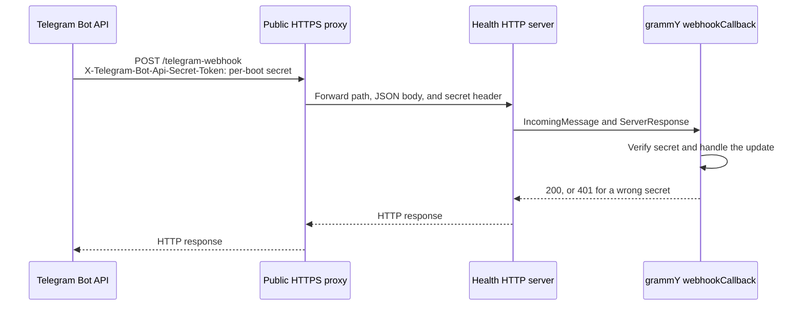

# Telegram webhook mode

Mimir normally receives Telegram updates by long polling. Set
`TELEGRAM_WEBHOOK_URL` to make it register a webhook instead. The public HTTPS
endpoint and the existing health endpoints share one Node HTTP server and one
`HEALTH_PORT`; webhook mode does not start a second listener.

## Request flow



The implementation has four steps:

1. When `TELEGRAM_WEBHOOK_URL` is set, [`src/index.ts`](../src/index.ts#L271-L295)
   generates 32 random bytes and hex-encodes them as a per-process secret.
2. The same secret is passed to grammY as `secretToken` and to Telegram's
   `setWebhook` call as `secret_token`.
3. Telegram includes the secret in the
   `X-Telegram-Bot-Api-Secret-Token` request header. grammY compares that exact
   header with the generated value and returns `401` when it is absent or does
   not match.
4. [`src/health.ts`](../src/health.ts#L415-L421) sends only
   `POST /telegram-webhook` to the grammY handler. The same listener continues
   to serve `GET /health`, `GET /healthz`, `GET /health/live`, and the other
   operational routes documented in the [README](../README.md#health-endpoint).

The secret is generated again on every process start and is not read from an
environment variable or written to disk. Each startup calls `setWebhook` with
the new value before logging that webhook setup succeeded. A proxy must
therefore forward `X-Telegram-Bot-Api-Secret-Token` unchanged; it must not
replace it with a fixed local secret. A request still in flight with the
previous process's secret can receive `401` after a restart.

## Configure the public endpoint

Set `TELEGRAM_WEBHOOK_URL` to the public HTTPS origin that reaches this process:

```dotenv
TELEGRAM_WEBHOOK_URL=https://bot.example.com
HEALTH_HOST=127.0.0.1
HEALTH_PORT=8787
```

The configured value must be an HTTP or HTTPS URL, as enforced by
[`src/config.ts`](../src/config.ts#L451-L463). Telegram needs a publicly
reachable HTTPS URL in normal deployments. Mimir resolves
`/telegram-webhook` from the URL root, replacing any path already present in
`TELEGRAM_WEBHOOK_URL`. The example above registers:

```text
https://bot.example.com/telegram-webhook
```

Do not set `HEALTH_PORT=0` in webhook mode because that disables the shared
listener. Keep the default loopback `HEALTH_HOST=127.0.0.1` when the reverse
proxy runs on the same host. In a container or when the proxy reaches the
process over a container network, bind an address it can reach, usually
`HEALTH_HOST=0.0.0.0`. When a platform supplies `PORT` and `HEALTH_PORT` is
unset, Mimir uses `PORT` for this listener.

Terminate TLS at the public proxy and forward this route to the listener
without rewriting its method, path, body, or secret header:

```text
HTTPS POST /telegram-webhook
  -> http://127.0.0.1:8787/telegram-webhook
```

The listener also contains operational endpoints. Configure the proxy to
publish only `/telegram-webhook` unless `/health` or another route is
intentionally public. No Telegram update route exists at `/`, `/webhook`, or
`/health`.

## Verify a deployment

After a restart:

1. Confirm the boot log reports `mode=webhook` and the redacted webhook URL.
2. Confirm the proxy sends `POST /telegram-webhook` to the same port that
   answers `GET /health`.
3. Confirm successful Telegram deliveries return a 2xx response. A `401`
   means the proxy omitted or changed `X-Telegram-Bot-Api-Secret-Token`, or a
   request used the secret from a previous process. A `404` usually means the
   method or path was rewritten.

Mimir awaits Telegram's `setWebhook` request during startup. If the Bot API
call fails or Telegram rejects the URL, startup does not silently fall back to
long polling.

## Switch back to long polling

1. Stop the webhook deployment from accepting new traffic.
2. Using the bot token through existing secret-management tooling, call
   Telegram's Bot API `deleteWebhook` method. Leave `drop_pending_updates`
   false or omitted unless discarding queued updates is an intentional
   operational decision.
3. Call `getWebhookInfo` and confirm its `url` field is empty.
4. Remove `TELEGRAM_WEBHOOK_URL` from the process environment and restart
   Mimir.

The application source does not make an explicit `deleteWebhook` call during
this mode switch. With `TELEGRAM_WEBHOOK_URL` unset,
[`src/index.ts`](../src/index.ts#L300-L318) starts grammY's long-polling loop.
The health listener can remain enabled for readiness and liveness checks; it
no longer accepts `POST /telegram-webhook` and returns `404` for that path.

Do not run webhook and long-polling instances for the same bot token at the
same time. Telegram permits only one update-delivery mode for a bot, and each
new webhook registration or long-polling startup replaces the previous mode.
